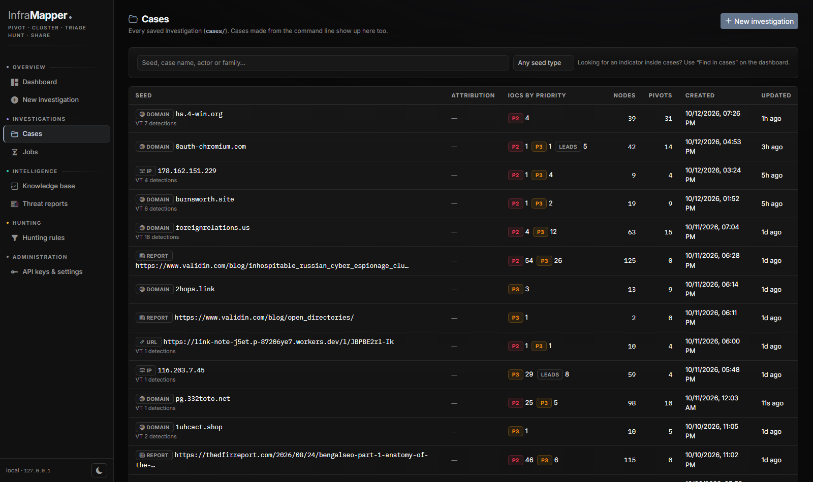
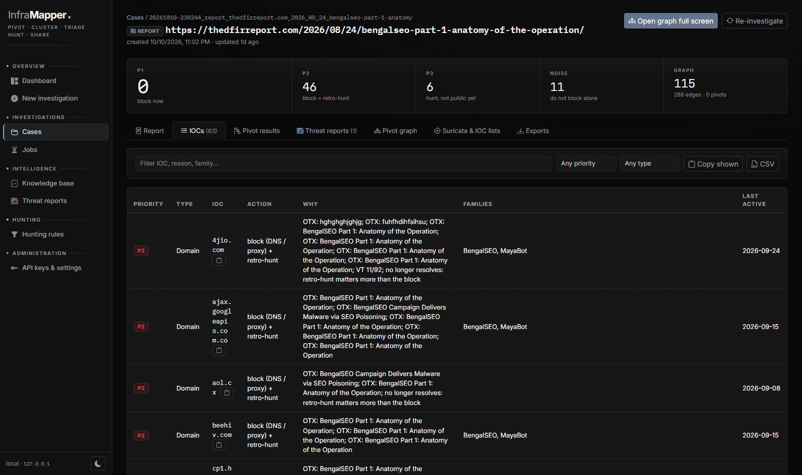

# InfraMapper

**One IOC in, the whole infrastructure mapped.**

Every indicator leads to the infrastructure behind it: the IPs it resolved to, the certificates it shares,
the pages built from the same kit. InfraMapper follows those links and maps them.

IOC investigation and pivoting tool. Give it a hash, IP, domain or URL (defanged is fine), or a threat report, and it
pivots through VirusTotal, urlscan.io and passive DNS, builds a relationship graph, checks each IOC against public
reporting and feeds, and triages it: block, hunt or ignore.


## Features

- Pivots on VirusTotal relations, urlscan.io scans (favicon, title, HTML/JS hashes, URL paths), passive DNS, NS/MX/SOA,
  TLS certificates and CT logs, and hosting (IP -> domains -> other IPs).
- Cluster scoring on specific shared artefacts; CDNs, shared hosting and broad pivots are kept out.
- Prior reporting and feeds: OTX, ThreatFox, MalwareBazaar, URLhaus, Feodo, C2IntelFeeds, OpenPhish, Spamhaus DROP,
  GreyNoise, AbuseIPDB, Shodan InternetDB, VT comments / YARA / sandboxes.
- Triage per IOC: `P1` block now, `P2` block + retro-hunt, `P3` hunt, `noise` don't block. What every label means: [documentation, section 4](docs/DOCUMENTATION.md#4-labels-at-a-glance).
- Attribution overlap across sources, with aliases merged (MISP galaxy, Malpedia) and timing checks.
- Report triage (`--from`): extracts IOCs from a PDF, web page or text and triages them.
- Regex and newly-registered-domain hunts.
- Your own hunting rules in the web UI: conditions, relations and urlscan / VT query templates, with Test (why it matched) and Run ([docs](docs/DOCUMENTATION.md#11-hunting-rules-your-own-hunting-logic)).
- Local knowledge base: links new cases to earlier ones and keeps analyst verdicts.
- Web UI and CLI.
- Exports: STIX 2.1, CSV, Suricata rules, IOC lists, KQL/SPL queries, Markdown report.

## Install

Python 3.10+.

```bash
git clone https://github.com/abdelghafourbouhdyd/InfraMapper.git
cd InfraMapper
python3 -m venv .venv
.venv/bin/pip install -r requirements.txt     # Windows: .venv\Scripts\pip ...
cp .env.example .env
```

Add your keys to `.env`. `VT_API_KEY` and `URLSCAN_API_KEY` are the main ones (both have free tiers). `OTX_API_KEY`,
`ABUSECH_API_KEY`, `ABUSEIPDB_API_KEY` and `GREYNOISE_API_KEY` are optional. Passive DNS (Mnemonic) and most feeds
work without a key.

## Usage

Web UI:

```bash
.venv/bin/python infra-mapper.py --web     # http://127.0.0.1:8770
```

New investigation, jobs, cases with the live graph, pivot scoring, hunting rules, threat reports, knowledge base and
API key settings. Local only by default; set `INFRAMAPPER_WEB_PASSWORD` before using `--web-host 0.0.0.0`.

Dashboard:


Cases:



Case report and triage:


Pivot results, scored for fidelity and confidence:


Report triage (DFIR Report, BengalSEO):



CLI:

```bash
.venv/bin/python infra-mapper.py evil-login-01[.]pages.dev          # investigate, then open the graph
.venv/bin/python infra-mapper.py 45.9.148.12 --depth 2
.venv/bin/python infra-mapper.py <sha256> --no-serve                # write the case and exit
.venv/bin/python infra-mapper.py --from report.pdf                  # triage a report (file, URL or -)
.venv/bin/python infra-mapper.py 1.2.3.4 evil[.]com <sha256>        # several IOCs
.venv/bin/python infra-mapper.py corp-sso.com -q 'page.title:"Sign in"' -r '.*-sso-[a-z]+\.com'
.venv/bin/python infra-mapper.py --serve cases/<case>               # reopen a case
```

| Flag | Default | |
|---|---|---|
| `--depth` | 1 | 2 also expands what the seed's pivots find |
| `--limit` | 10 | objects per VT relation / urlscan pivot |
| `--max-expand` | 40 | cap on expanded nodes |
| `--vt-intel` | | VT Intelligence hunts (premium key) |
| `--vt-rpm` | 4 | VT requests per minute |
| `-q` / `-r` | | extra urlscan queries / domain regexes |
| `--tlp` | amber | TLP on the STIX export |
| `--no-serve` | | don't start the graph server |
| `--no-pdns` / `--no-feeds` / `--no-intel` | | skip pDNS / feeds / prior reporting |
| `--mark fp\|confirmed\|clear <ioc>` | | analyst verdict (`--actor`, `--family`, `--note`) |

`--help` lists everything. Full documentation (every feature, option and label): [docs/DOCUMENTATION.md](docs/DOCUMENTATION.md).

## Output

Each case goes to `cases/<timestamp>_<seed>/`:

- `graph.html` interactive graph
- `report.md` verdict, triage, attribution, DNS history, pivots, hunting queries
- `iocs.csv` IOCs with priority, action and reasons
- `stix2.json` STIX 2.1 bundle (OpenCTI / MISP)
- `hunt/` Suricata rules, IOC lists, KQL / SPL
- `graph.json` raw graph

## Threat report dataset (optional)

Builds a local STIX dataset from 50 research sources (DFIR Report, Unit 42, Mandiant, Microsoft, Talos, ESET...).
Investigations check their IOCs against it.

```bash
.venv/bin/python infra-mapper.py --ingest                  # last 60 days
.venv/bin/python infra-mapper.py --search-reports Lumma
```

## Tests

```bash
.venv/bin/pip install pytest && .venv/bin/python -m pytest -q tests
```

## Note

Indicators you investigate are sent to the services you configure. Don't submit internal or sensitive data.
Attribution from the tool is a lead, not a conclusion.
