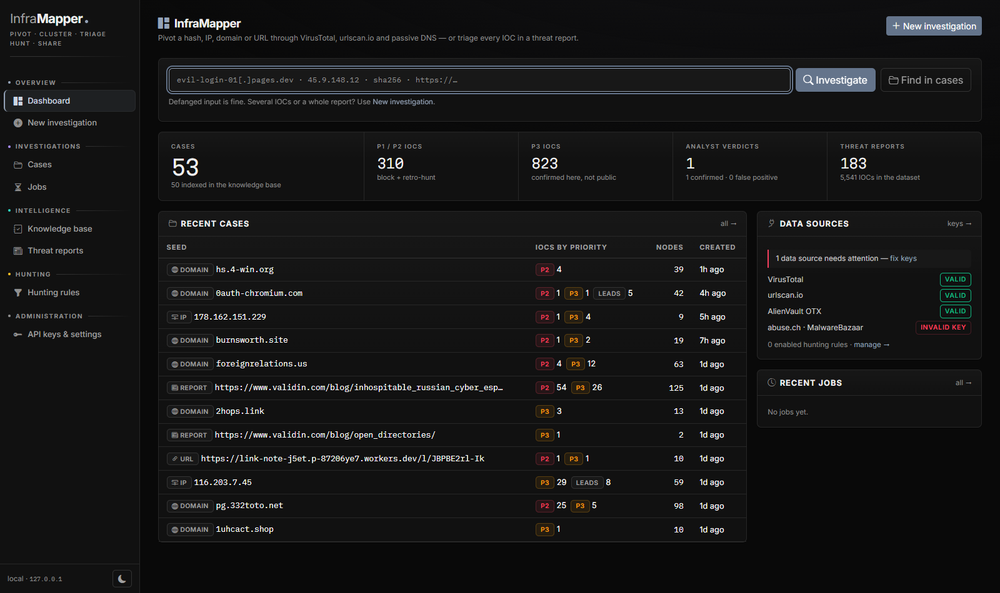
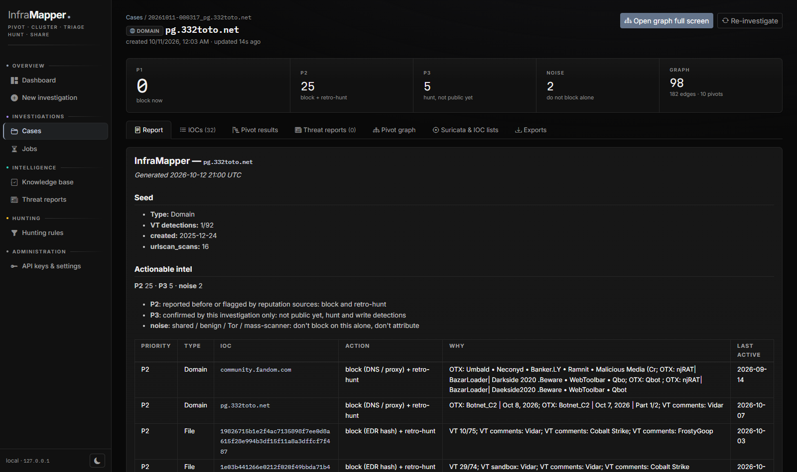
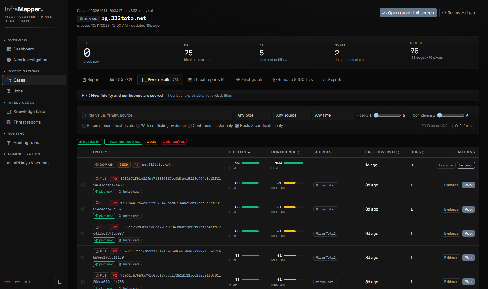
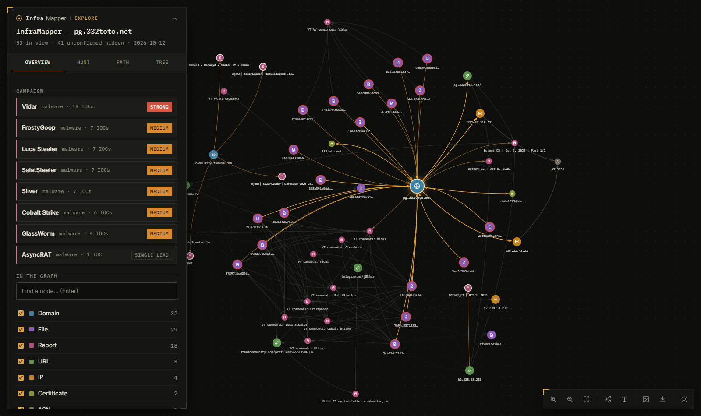

# InfraMapper documentation

InfraMapper takes one IOC (hash, IP, domain, URL; defanged is fine) or a whole threat report. It pivots
through VirusTotal, urlscan.io and passive DNS, decides which discovered hosts belong to the attacker,
checks each one against public reporting and feeds, and gives each a priority: block now, block,
hunt, or ignore.

**Contents**

1. [Install and configure](#1-install-and-configure)
2. [Run it](#2-run-it)
3. [What happens during an investigation](#3-what-happens-during-an-investigation)
4. [Labels at a glance](#4-labels-at-a-glance)
5. [Pivots](#5-pivots)
6. [Cluster scoring: confirmed vs unconfirmed](#6-cluster-scoring-confirmed-vs-unconfirmed)
7. [Prior reporting and public feeds](#7-prior-reporting-and-public-feeds)
8. [Triage: P1, P2, P3, noise](#8-triage-p1-p2-p3-noise)
9. [Attribution](#9-attribution)
10. [Hunts: regex, tightening, new domains, hosting](#10-hunts-regex-tightening-new-domains-hosting)
11. [Hunting rules: your own hunting logic](#11-hunting-rules-your-own-hunting-logic)
12. [Report triage (`--from`)](#12-report-triage---from)
13. [Knowledge base and analyst verdicts](#13-knowledge-base-and-analyst-verdicts)
14. [Fidelity and confidence scores](#14-fidelity-and-confidence-scores)
15. [Output files](#15-output-files)
16. [Threat report dataset (`--ingest`)](#16-threat-report-dataset---ingest)
17. [Web UI](#17-web-ui)
18. [Live pivot graph (`--serve`)](#18-live-pivot-graph---serve)
19. [All command-line options](#19-all-command-line-options)
20. [Tests](#20-tests)

---

## 1. Install and configure

Python 3.10+.

```bash
git clone https://github.com/abdelghafourbouhdyd/InfraMapper.git
cd InfraMapper
python3 -m venv .venv
.venv/bin/pip install -r requirements.txt      # Windows: .venv\Scripts\pip install -r requirements.txt
cp .env.example .env
```

PDF reports need `pdftotext` (poppler-utils) or `pip install pypdf`.

### API keys (`.env`)

Only `VT_API_KEY` and `URLSCAN_API_KEY` matter for a basic run. Everything else is optional and makes
results more complete.

| Variable | Used for | Without it |
|---|---|---|
| `VT_API_KEY` | VirusTotal relations, verdicts, comments | no VT pivots |
| `VT_API_KEY_BACKUP` | extra VT keys, comma-separated; the next one takes over when a key hits its quota (429) or is rejected (401) | stops at the first key's quota |
| `VT_RPM` | VT requests per minute (free key = 4) | 4 |
| `URLSCAN_API_KEY` | urlscan.io searches and scans | no urlscan pivots |
| `MNEMONIC_API_KEY` | passive DNS, higher quota | Mnemonic still works, small quota |
| `CIRCL_PDNS_USER` / `CIRCL_PDNS_PASS` | second passive DNS source (merged) | Mnemonic only |
| `OTX_API_KEY` | prior reporting: OTX pulses | not checked |
| `ABUSECH_API_KEY` | ThreatFox, MalwareBazaar, URLhaus | not checked |
| `GREYNOISE_API_KEY` | GreyNoise (benign services, mass scanners) | community API, lower limits |
| `ABUSEIPDB_API_KEY` | AbuseIPDB reputation | not checked |
| `CERTSPOTTER_API_KEY` | Certificate Transparency, more queries | about 10 queries per hour |
| `IOCI_WEB_HOST` / `IOCI_WEB_PORT` | web UI address (default `127.0.0.1:8770`) | defaults |
| `IOCI_WEB_PASSWORD` | web UI sign-in; **required** to listen on anything but localhost | localhost only |

Keyless sources: Feodo Tracker, C2IntelFeeds, OpenPhish, Spamhaus DROP, IPsum, the Tor exit list,
Shodan InternetDB, MISP warninglists, crt.sh, Cloudflare DNS-over-HTTPS.

---

## 2. Run it

```bash
# one IOC: full investigation, then the live graph opens in your browser
.venv/bin/python ioc_investigator.py evil-login-01[.]pages.dev

# same, but just write the case and exit (scripts, cron)
.venv/bin/python ioc_investigator.py evil-login-01[.]pages.dev --no-serve

# go one level deeper
.venv/bin/python ioc_investigator.py 45.9.148.12 --depth 2

# a threat report (file, URL or stdin): extract and triage every IOC in it
.venv/bin/python ioc_investigator.py --from report.pdf
.venv/bin/python ioc_investigator.py --from https://thedfirreport.com/2024/08/26/blacksuit-ransomware/
pbpaste | .venv/bin/python ioc_investigator.py --from -

# several IOCs on the command line = report triage
.venv/bin/python ioc_investigator.py 1.2.3.4 evil[.]com <sha256>

# extra urlscan queries and domain-name regexes to pivot on
.venv/bin/python ioc_investigator.py corp-sso.com -q 'page.title:"Sign in"' -r '.*-sso-[a-z]+\.(com|net)'

# reopen a saved case in the live graph
.venv/bin/python ioc_investigator.py --serve cases/<case>

# web UI
.venv/bin/python ioc_investigator.py --web
```

Each case is saved in `cases/<date>-<time>_<seed>/`.

---

## 3. What happens during an investigation

In order:

1. **Parse the seed.** Defanged input is cleaned up (`hxxps`, `[.]`, `(.)`, `[dot]`…).
2. **Pivot** from the seed through VirusTotal, urlscan.io and passive DNS ([section 5](#5-pivots)).
   With `--depth 2`, the hosts found are expanded too (at most `--max-expand`, default 40).
3. **Score the cluster.** Each discovered host gets evidence points. At 2 or more it is
   *confirmed* as part of the attacker's infrastructure ([section 6](#6-cluster-scoring-confirmed-vs-unconfirmed)).
4. **Hunt for more**: regex ladder on the attacker's domain names, tightening of too-broad pivots,
   new-domain hunt, hosting pivot ([section 10](#10-hunts-regex-tightening-new-domains-hosting)).
5. **Check prior reporting and feeds** for every confirmed IOC ([section 7](#7-prior-reporting-and-public-feeds)).
6. **Triage** every confirmed IOC into `P1`, `P2`, `P3` or `noise` ([section 8](#8-triage-p1-p2-p3-noise)).
7. **Attribute**: merge every source that names an actor or malware family ([section 9](#9-attribution)).
8. **Write the case** ([section 15](#15-output-files)), index it in the knowledge base, and open the live graph.

API responses are cached in `.cache/` for 24 hours (`--cache-ttl`), so re-running costs no quota.

---

## 4. Labels at a glance

| Label | Where you see it | Means | Do this |
|---|---|---|---|
| `P1` | report, `iocs.csv`, graph | Active malicious infrastructure, live right now | Block now, retro-hunt 90 days |
| `P2` | same | Reported or flagged before by public sources | Block, then retro-hunt |
| `P3` | same | Tied to the attack by this investigation only; not public yet | Retro-hunt, watchlist, write a detection |
| `noise` | same | Shared, benign, or useless for attribution | Don't block on this alone; never attribute |
| `lead-strong` | report, `iocs.csv`, graph (dashed teal ring) | New look-alike domain with infrastructure overlap | Block proactively, monitor |
| `lead-medium` | same | New look-alike domain, less evidence | Watchlist, re-check in a few days |
| `lead-weak` | same | Name match only | Review |
| confirmed | graph, report | Host belongs to the attacker's cluster (score ≥ 2) | It's triaged and exported |
| unconfirmed | graph (hidden by default) | Look-alike without enough evidence | Ignored unless you pivot on it |
| `fits` | report, graph | Public report date matches when the IOC was used here | Counts |
| `current` | same | Listed on a feed now; no usage dates to compare | Counts |
| `earlier` | same | Reported long before this use: probably a previous owner | Doesn't count |
| `later` | same | Reported long after this use: probably reassigned | Doesn't count |
| `strong` / `medium` / `single lead` | Attribution overlap | How well an actor or family is backed up | A lead for the analyst, not a final call |
| `linked` / `possible` / `weak` / `shared hosting` / `unverified` | Hosting pivot | Whether another IP is the same operator's server | Only `linked` and `possible` count |
| high / medium / low / very low | Pivot results | Fidelity and confidence bands (75 / 50 / 25 / 0) | Sort and filter on them |
| `seen in N cases` | graph, report | IOC or fingerprint appeared in earlier cases | Context; check those cases |
| `reported ×N` | graph | N public reports mention the IOC | Context |

---

## 5. Pivots

| From | Source | What it finds |
|---|---|---|
| File | VirusTotal | contacted domains / IPs / URLs, dropped files, execution parents, in-the-wild URLs, embedded domains / IPs, threat label; imphash / vhash with `--vt-intel` (premium key) |
| File | urlscan | `hash:<sha256>`: pages that served the file |
| Domain / IP | VirusTotal | resolutions, communicating / downloaded / referrer files, subdomains, URLs, TLS certificate, JARM, ASN |
| Domain / IP | urlscan | scans of the host: IPs, ASNs, URLs, redirect chains, certificates; sites loading resources from the domain |
| urlscan scan | urlscan | favicon SHA-256 (plus Shodan / FOFA favicon hashes as hunting queries) |
| urlscan scan | urlscan | page title (`page.title:"…"`; generic titles skipped) |
| urlscan scan | urlscan | main HTML body hash and up to 3 first-party JavaScript hashes (cloned phishing kits) |
| urlscan scan | urlscan | URL path pattern (`page.url:*\/seg1\/seg2*`) |
| Domain | urlscan | domain-name patterns: same name on other TLDs, name without its random / digit suffix, hyphen-token combinations, subdomain structure, free-hosting prefix skeleton (`wk-auto-update-*.pages.dev`) |
| Domain | passive DNS | resolution history (A / AAAA / CNAME with first and last seen); current NS / MX / SOA over DNS-over-HTTPS |
| IP | passive DNS | reverse resolution: every domain that pointed to the IP, and when |
| Nameserver / MX | passive DNS | other domains using the same non-commodity nameserver or mail server |
| Domain | DNS-over-HTTPS | SOA contact email: a registrant fingerprint that survives WHOIS privacy |
| Certificate | VirusTotal / CT logs | every name in the certificate's SAN list; subdomains from other certificates of the domain |

**Broad pivots.** A urlscan pivot with more than `--broad` (250) hits isn't expanded. It's shown greyed
out with sample domains, and the tool tries to tighten it ([section 10](#10-hunts-regex-tightening-new-domains-hosting)).
A nameserver or MX used by more than `--ns-broad` (200) domains isn't expanded. An IP with more than
`--pdns-broad` (25) domains in passive DNS is shared hosting: its other domains aren't attached.

---

## 6. Cluster scoring: confirmed vs unconfirmed

Pivots return many look-alikes. A discovered host is **confirmed** only when its evidence reaches
**2 points** (`--min-score`; 1 = any single hit, 3 = strong artefacts only). Points come from links to
hosts that are already confirmed, starting with the seed, and are recomputed until nothing changes, so a
host confirmed through the seed can confirm others.

| Evidence | Points |
|---|---|
| Same HTML body hash, first-party script hash, TLS certificate or SOA contact email as a confirmed host | 3 |
| Direct relation to the seed (the seed's parent domain only gets 1) | 2 |
| Resolved to the same **dedicated** IP as a confirmed domain **in an overlapping window** (±7 days) | 2 |
| Same URL path pattern, analyst query, imphash or vhash | 2 |
| Nameserver / mail server self-hosted under a cluster domain (`ns1.<cluster domain>`) | 2 |
| Strong relation to another confirmed host (resolves to, contacts, drops, redirects, served by, loads from) | 1 |
| Same IP as a confirmed domain, but years apart | 1 |
| Third-party nameserver / mail server (counted once per type) | 1 |
| Same domain-name pattern, page title, favicon or JARM | 1 |
| Named in the same VirusTotal comment as a confirmed host | 1 |
| VirusTotal flags it malicious | 1 |
| Commodity DNS (Cloudflare, GoDaddy, Namecheap, AWS, parking), shared hosting IP | 0 |

Examples:

- Same page title only: 1 point, unconfirmed.
- Same page title + same dedicated IP at the same time: 1 + 2 = 3, confirmed.
- Same TLS certificate: 3, confirmed on its own.

Analyst verdicts override the score: **confirmed** makes the IOC a co-seed; **false positive** keeps it
out for good and makes it weigh 0 as a shared artefact.

Unconfirmed hosts are hidden in the graph (*Show unconfirmed pivot hits* shows them) and are never
triaged or exported.

---

## 7. Prior reporting and public feeds

Every confirmed IOC (up to `--intel-max`, default 200 per run) is checked against:

### Prior reporting

| Source | Gives | Key |
|---|---|---|
| AlienVault OTX pulses | report name and link, adversary, malware family, ATT&CK ids (most vendor reports are mirrored as pulses) | `OTX_API_KEY` |
| ThreatFox | malware family, C2 tags, first seen | `ABUSECH_API_KEY` |
| MalwareBazaar (hashes) | family signature, tags, first seen | `ABUSECH_API_KEY` |
| Local report dataset ([section 16](#16-threat-report-dataset---ingest)) | vendor report, actors, families, the IOC's role | none |
| VirusTotal comments | actors, families, co-mentioned IOCs, links to reports (`--vt-comments`, default 10 IOCs, 1 VT call each) | `VT_API_KEY` |
| VirusTotal YARA, sandboxes, AV consensus (3+ engines), partner context | actor / family names, no extra VT call | `VT_API_KEY` |

### Public feeds

Bulk lists are cached in `.cache/feeds/` and refreshed every 6–24 hours.

| Feed | Matches | Gives |
|---|---|---|
| Feodo Tracker | IP | live botnet C2: family, port, online / offline |
| C2IntelFeeds | IP, domain | Cobalt Strike C2 from the last 90 days; fronting domains flagged |
| OpenPhish | URL, hostname | live phishing |
| URLhaus | IP, domain, URL, hash | malware URLs, how many online now, payload family |
| Spamhaus DROP / ASN-DROP | IP, ASN | hijacked or criminal netblock |
| IPsum | IP | number of public blocklists listing it |
| Tor exit list | IP | Tor exit node |
| GreyNoise | IP | RIOT = known benign service; noise = mass scanner |
| Shodan InternetDB | IP | open ports, CPEs, tags, CVEs (checked against CISA KEV), default C2 ports (50050, 31337, 40056, 7443) |
| AbuseIPDB | IP | abuse score, report count, usage type |

`--no-intel` skips prior reporting. `--no-feeds` skips feeds. `--no-live-feeds` uses the bulk lists only.

### Guards against false attribution

- **MISP warninglists** (public resolvers, CDNs, Microsoft 365, top 10k sites, known-good hashes):
  matching IOCs are marked known benign and never looked up. Hostnames match exactly: `pages.dev` on the
  list doesn't clear `evil.pages.dev`.
- **Timing check.** Every report on an IP or domain is compared with when the IOC was used in this case
  (passive DNS dates), with 180 days of slack:

  | Tag | Means | Counts? |
  |---|---|---|
  | `fits` | report date within the usage window | yes |
  | `current` | on a feed right now; the case has no usage dates | yes |
  | `earlier` | reported long before this use: previous owner | no |
  | `later` | reported long after: address reassigned | no |

- **Rented ranges.** For cloud, VPS, VPN and Tor IPs (AWS, Azure, GCP, Hetzner, OVH…), reports only link
  when the timing fits; otherwise the node says *not attributed*.
- **Sandbox noise.** An IOC in more than 50 OTX pulses (Windows Update, Google…) isn't attributed.
- **VT bulk comments.** A comment listing more than 25 IOCs links nothing.

Reports and feed hits appear as **Report** nodes (pink) linked to the IOC. They are context: they
**don't add cluster points**. They drive triage and attribution.

---

## 8. Triage: P1, P2, P3, noise

Each confirmed IP, domain, URL and file gets exactly one priority. Certificates, favicons, titles and
other artefacts don't get one.

**Rules are checked in this order; the first match wins.**

| Step | Result | When | Action |
|---|---|---|---|
| 1 | `noise` | analyst marked it false positive | ignore |
| 2 | `noise` | MISP warninglist (known benign / shared service) | ignore |
| 3 | `noise` | legit domain used for domain fronting | don't block the domain; hunt the HTTP `Host` header |
| 4 | `noise` | Tor exit node | block by policy only, never attribute |
| 5 | `noise` | IP is shared hosting (> 25 domains) | block the cluster's domains, not the IP |
| 6 | `P1` | on a **live** feed (Feodo, C2IntelFeeds, OpenPhish, URLhaus online) with fitting timing, **or** in Spamhaus DROP / ASN-DROP, **or** Shodan tags it `c2` | block now (+ the DROP netblock), retro-hunt 90 days |
| 7 | `noise` | GreyNoise mass scanner | edge block optional, not campaign infrastructure |
| 8 | `P2` | earlier reporting with fitting timing (OTX, ThreatFox, MalwareBazaar, offline URLhaus, report dataset), **or** VT ≥ 3 detections, **or** AbuseIPDB ≥ 75 %, **or** on ≥ 3 blocklists (IPsum), **or** a default C2 port open | block + retro-hunt |
| 9 | `P3` | anything else that is confirmed | retro-hunt, watchlist, candidate for a new detection |

Why the order matters: a Tor exit on a C2 feed is `noise` (step 4 comes before step 6), because
thousands of people share that IP.

**VT names alone never make a `P2`.** Names from VT comments, YARA, sandboxes and AV labels describe the
file; they aren't vetted reporting. They're added as supporting reasons when something else already
made it a `P2`. VT detection counts (step 8) do count.

**Block location** in the action text: IP → firewall / proxy, domain → DNS / proxy, URL → proxy,
file → EDR hash.

**Notes that can appear with a priority:**

| Note | Meaning |
|---|---|
| `caveat: rented / VPN range` | cloud or VPN IP; check it's still the attacker's before blocking |
| `no longer resolves` | dead domain: the block protects little, the retro-hunt matters more |
| `listed on X but outside the time it was used here` | the report is about a previous or next owner (`P3` only) |
| `only in the input report` | report triage: nothing public backs it up yet (`P3`) |

**What's exported** (STIX, hunt lists, Suricata):

| Label | STIX `confidence` | Exported |
|---|---|---|
| `P1` | 85 | yes |
| `P2` | 70 | yes |
| `P3` | 50 | yes |
| `lead-strong` | 40 | yes |
| `lead-medium` | 25 | yes |
| `lead-weak` | — | no |
| `noise` | — | **never**: sharing a CDN IP as "attacker infrastructure" is how false attribution spreads |

### Worked example

Seed `evil-login.example`:

| IOC | Label | Why |
|---|---|---|
| `198.51.100.23` | `P1` | on Feodo Tracker right now, timing `fits` |
| `evil-login.example` | `P2` | 9/91 VT engines flag it |
| `evil-login2.example` | `P3` | same HTML kit as the seed (3 points); no public source knows it |
| `104.16.0.1` | `noise` | Cloudflare (MISP warninglist) |
| `evil-login.example.net` | `lead-strong` | same kit, registered 3 days ago, same nameserver |
| `203.0.113.50` | `P3` | OTX lists it, but the report is `earlier` (2021): previous owner |

Do: block `198.51.100.23` now; block `evil-login.example`; retro-hunt all confirmed hosts; write a
detection for the HTML kit; block `evil-login.example.net` proactively; leave the Cloudflare IP alone.

---

## 9. Attribution

The **Attribution overlap** section of `report.md` merges every source that names an actor or malware
family. Aliases are merged through the MISP threat-actor galaxy and Malpedia (`Fancy Bear` =
`Forest Blizzard` = `APT28`; `wannacry` = `WannaCryptor`).

It counts **distinct IOCs** and **independent source groups**. Sources with shared data count once:

| Group | Sources |
|---|---|
| abuse.ch | ThreatFox, MalwareBazaar, URLhaus, Feodo Tracker |
| OTX | OTX pulses |
| C2IntelFeeds, OpenPhish | each its own group |
| VT community | VT comments |
| YARA rules / sandboxes / AV engines / VT partners | each its own group |
| report dataset | each vendor is its own group |
| analyst | your verdict labels |

| Strength | Rule | Assessment wording |
|---|---|---|
| `strong` | 3+ IOCs from 2+ groups, or 2+ IOCs from 3+ groups | "is **likely** linked to X (moderate confidence)" |
| `medium` | 2 IOCs, or 2 groups | "**may** be linked to X (low confidence)" |
| `single lead` | 1 IOC, 1 group | listed only |
| analyst | you labelled IOCs with this actor / family | ranked first, not capped |

Confidence is **capped at moderate**: a tool finding sources that agree is a lead. Raising it is the
analyst's call after checking TTPs and infrastructure. Names only backed by reports with the wrong
timing are listed separately; two actors each named by several IOCs are flagged as a conflict.

One-word aliases that are also common words or malware names (`Cobalt`, `Equation`, `Winnti`) only count
as a `#hashtag` or VT tag, never in free text, so "Cobalt Strike" never means "Cobalt Group".

---

## 10. Hunts: regex, tightening, new domains, hosting

### Regex hunt (`-r`, Hunt tab; automatic unless `--no-regex-hunt`)

Searches urlscan for domain names matching a regex, starting broad and narrowing only by what the hits
show. At most 6 searches per ladder.

1. **Broad:** your regex, or the most distinctive word in the attacker's domain names (`.*acme.*`).
   Words every kit uses (login, secure, account) are skipped.
2. **Analyse 100 hits** and propose refinements the sample justifies: a more specific word, excluding
   one site that swamps the hits, registered name vs subdomain, the attacker's TLDs, last 90 days.
3. A refinement must still match every known attacker domain. It's kept if it cuts hits by at least a
   fifth.
4. Stop at the first step with ≤ `--broad` (250) hits: its hits join the graph (a name match is 1 point,
   so they still need corroboration).

Example: `.*acme.*` 10,000+ hits → `.*acmesec.*` 4,008 → `(.*\.)?acmesec\.[a-z]+` **9** (the same name on other TLDs).

urlscan regexes match the **whole** name, TLD included: write `.*-okta-[a-z]+\.com`, not
`.*-okta-[a-z]+`. Use `[0-9]` and `[a-z0-9]`, not `\d` and `\w`.

### Tightening too-broad pivots (`--refine`, default 6 searches; 60 per run)

A urlscan pivot over `--broad` hits is tightened in a loop, using the scan it came from:

1. longer URL path (`/dynamic` → `/a/dynamic`), then its query keys (`/dynamic?txd=`)
2. exclude the domain making up ≥ 30 % of the sample (up to 2)
3. add `date:>now-90d`, the same page title, `page.server`, `page.asn`, `page.country`

After each search: ≤ 250 hits → good pivot, expanded. 0 hits → step dropped. ≥ 20 % fewer hits → step
kept. Less → step dropped. Every attempt is listed under *Pivots run* in `report.md`.

### New-domain hunt (automatic unless `--no-new-hunt`)

Looks for domains the attacker registered recently:

1. **Kit reuse on young domains** (urlscan): every artefact pivot (HTML, script, favicon, URL path,
   title, domain pattern) re-run with `page.apexDomainAgeDays:<30` (`--young-days`). Older matches are
   listed as *older domains reusing the kit*.
2. **Newly registered domains** (hagezi/nrd, ~400k a day, last `--nrd-days` = 7) matched against
   look-alike rules: same name on another TLD, one-character typo or homoglyph (`claus3doom` →
   `c1aus3doom`), name skeleton (`wk-auto-update-*`), token pair in either order. Rules come only from
   domains the attacker probably registered (seed, cluster domains under 180 days old). A rule matching
   more than 40 domains is dropped as too generic.
3. **Certificate Transparency** (crt.sh): fresh certificates for the attacker's names (`--no-ct` skips).

Each lead gets live DNS and is compared with the cluster's IPs and nameservers:

| Points | For |
|---|---|
| 1 | artefact or name match |
| +2 | same dedicated IP or nameserver as the cluster |
| +1 | registered this week |

| Score | Label | Action |
|---|---|---|
| ≥ 4 | `lead-strong` | block proactively + monitor |
| 3 | `lead-medium` | watchlist, re-check in a few days |
| ≤ 2 | `lead-weak` | review |

Leads aren't confirmed cluster members. Pivot on one or mark it *Confirmed* to pull it in. The
look-alike rules are also exported as regexes for DNS-log or certstream monitoring.

### Hosting pivot (automatic unless `--no-hop`; passive DNS only, no VT / urlscan quota)

For up to 5 anchor IPs (seed IP, seed domain's IPs, then confirmed IPs):

1. take the domains that resolved to the anchor (`--hop-domains`, 15)
2. list every other IP those domains used (domains on more than 20 IPs = fast flux / CDN, skipped)
3. reverse-lookup the top candidates (`--hop-siblings`, 8): how many anchor domains each hosted, and when

| Verdict | When | Counts? |
|---|---|---|
| `linked` | 2+ shared domains with at least one concurrent or moved within 30 days, or 3+ shared domains | yes: likely the same operator |
| `possible` | 1 shared domain with tight timing | yes |
| `weak` | shared domains, years apart | no |
| `shared hosting` | candidate hosts > 25 domains | never |
| `unverified` | reverse lookup returned nothing (quota out) | never |

Domains found on `linked` / `possible` IPs join the graph and go through normal cluster scoring.
Mnemonic's free quota is small; a `MNEMONIC_API_KEY` or CIRCL account makes this much more complete.

---

## 11. Hunting rules: your own hunting logic

Web UI → **Hunting rules**. A rule describes what to look for in your case graphs; you test it, then run
an action on what it finds. No code needed. Rules are stored in `cases/hunt_rules.json` and apply to every
case.

Rules run **only when you click Test or Run**. They never run on their own during an investigation.

### Parts of a rule

| Part | Options |
|---|---|
| Name, description, category, tags | your labels. Categories: infrastructure, phishing, malware, c2, certificate, dns, reputation, other |
| Target | the entity type to look at: Domain, IP, URL, File, Certificate, JARM, Favicon, Title, HtmlHash, Script, NameServer, MailServer, SoaEmail, ASN, Report, or **any** |
| Conditions | up to 20 checks on the entity itself (fields below) |
| Relations | up to 5 checks on its neighbours in the graph (below) |
| Match | **all**: every condition and relation must hold. **any**: one is enough |
| Minimum confidence / fidelity | optional 0–100 gates ([section 14](#14-fidelity-and-confidence-scores)) |
| Action | what **Run** does with the matches (below) |
| Enabled | a disabled rule can still be tested, but its action won't run |

### Condition fields

| Field | Type | Example use |
|---|---|---|
| `value` | text | the indicator itself: `value` regex `^login-[a-z]+\.` |
| `tld` | text | `tld` is one of `top, xyz, shop` |
| `apex` | text | registered domain of a domain / URL |
| `vt_malicious` | number | VT engines flagging it: `vt_malicious` ≥ 3 |
| `asn`, `as_owner`, `country` | text | `as_owner` contains `hetzner` |
| `registrar` | text | `registrar` contains `namecheap` |
| `age_days` | number | domain age: `age_days` ≤ 30 |
| `issuer`, `subject_cn` | text | certificate: `issuer` contains `Let's Encrypt` |
| `san` | list | names on a certificate |
| `title` | text | page title from urlscan |
| `file_type`, `name`, `label` | text | file type, file name, VT threat label |
| `families`, `actors`, `tags` | list | `families` contains `Vidar` |
| `open_ports`, `cpes` | list | `open_ports` contains `50050` |
| `priority` | text | `priority` is one of `P1, P2` |
| `verdict` | text | analyst verdict: `fp` or `confirmed` |
| `cluster`, `shared_hosting`, `expanded` | yes / no | in the confirmed cluster; shared hosting IP; already pivoted |
| `confidence`, `fidelity` | number | scores 0–100 |
| `degree` | number | number of links in the graph |
| `prop:<name>` | text | any other stored property, e.g. `prop:registrar_url` |

**Operators**

| Field type | Operators |
|---|---|
| text | `=`, `≠`, contains, does not contain, starts with, ends with, matches regex, is one of, is not one of, is set, is not set |
| number | `=`, `≠`, `>`, `≥`, `<`, `≤`, is one of, is not one of, is set, is not set |
| list | contains, does not contain, `=`, is one of, matches regex, is set, is not set |
| yes / no | `=` |

### Relations: conditions on neighbours

A relation says: *"this entity has at least **N** neighbours, linked by relation **R** in direction
**D**, of type **T**, that meet these conditions"*.

| Setting | Options |
|---|---|
| Relation | `RESOLVES_TO`, `USES_CERT`, `HAS_JARM`, `CONTACTS`, `DROPS`, `DOWNLOADED_FROM`, `EMBEDS`, `HAS_URL`, `HAS_SUBDOMAIN`, `HOSTED_ON`, `REDIRECTS_TO`, `SERVES`, `SERVED_FROM`, `IN_ASN`, `USES_NS`, `USES_MX`, `SOA_CONTACT`, `HAS_TITLE`, `HAS_FAVICON`, `SERVES_HTML`, `SERVES_SCRIPT`, `REPORTED_IN`, `CO_MENTIONED`, `SEEN_ON`, `MATCHES_PATTERN`, `CNAME_TO`, `LOADS_FROM`, or any |
| Direction | **out** (this entity → neighbour, e.g. domain `RESOLVES_TO` IP), **in** (neighbour → this entity, e.g. IP `USES_CERT` certificate, seen from the certificate), or either |
| Neighbour type | any entity type, or any |
| Minimum | how many matching neighbours are needed (default 1) |
| Conditions | up to 10, same fields and operators as above, with their own all / any |

### Actions

| Action | What Run does |
|---|---|
| **none** | lists the matches only |
| **pivot** | pivots on the matches with the sources you pick (VT, urlscan, passive DNS, CT). Skips entities already pivoted and types that can't be pivoted (only File, Domain, IP, URL, Certificate can) |
| **query** | runs a search built from a template on **urlscan** or **VirusTotal Intelligence** (premium key) for each match. Hits join the case and are scored like any pivot |

**Max actions** (default 5, at most 25): how many matches the action runs on. The best matches go first
(highest fidelity, then confidence).

**Query placeholders**, filled from each match:

| Placeholder | Becomes |
|---|---|
| `{value}` | the entity's value |
| `{host}` | its hostname (for URLs and domains) |
| `{apex}` | its registered domain |
| `{prop:name}` | any stored property, e.g. `{prop:urlscan_title}`, `{prop:imphash}`, `{prop:subject_cn}` |

A match where a placeholder has no value is skipped. Examples:

| Platform | Template | Finds |
|---|---|---|
| urlscan | `page.title:"{prop:urlscan_title}"` | sites with the same page title |
| urlscan | `hash:{value}` | same favicon / HTML / script (on those nodes) |
| urlscan | `page.domain:*{apex}* AND NOT page.domain:{apex}` | look-alikes of the domain |
| urlscan | `page.ip:"{value}"` | pages served by this IP |
| VT | `entity:domain jarm:{value}` | domains with this JARM (on JARM nodes) |
| VT | `entity:file imphash:{prop:imphash}` | files with the same imphash |
| VT | `entity:ip ssl_subject:{prop:subject_cn}` | IPs serving a certificate with this CN |

### Test and Run

| Button | Scope | What it does |
|---|---|---|
| **Test** | all cases or one case; works on an unsaved rule | lists what matches and **why**: every clause that held, with the value it saw. No pivots, no API quota |
| **Run** | one case | evaluates the rule on the live case, then runs its action on the best matches. New results are saved to the case, scored and triaged |

### Built-in templates

Copy one and adjust it:

| Template | Target | Logic | Action |
|---|---|---|---|
| Certificate served by a flagged IP | Certificate | used by an IP with `vt_malicious` ≥ 1 | pivot with CT + VT |
| Young domain on a confirmed IP | Domain | `age_days` ≤ 60 **and** resolves to a cluster IP that isn't shared hosting or Cloudflare | pivot with VT + urlscan + pDNS |
| Samples talking to P1/P2 infrastructure | File | contacts a host with `priority` P1 or P2 | none |
| Phishing kit reuse by page title | Domain | in the cluster, has a title, fidelity ≥ 50 | urlscan `page.title:"{prop:urlscan_title}"` |
| JARM fingerprint hunt on VT Intelligence | JARM | used by a cluster host | VT `entity:domain jarm:{value}` |
| Unpivoted high-fidelity leads | any | not pivoted yet, fidelity ≥ 60, confidence ≥ 50 | pivot with all sources |

### Example: Vidar C2 on fresh domains

Goal: find young domains, tied to Vidar, that sit on a dedicated server, and pivot on them.

| Setting | Value |
|---|---|
| Target | Domain |
| Match | all |
| Condition 1 | `age_days` ≤ 30 |
| Condition 2 | `families` contains `Vidar` |
| Relation | `RESOLVES_TO`, out, IP, minimum 1, with `shared_hosting` = no **and** `as_owner` does not contain `cloudflare` |
| Action | pivot with VT + urlscan + pDNS, max 5 |

**Test** across all cases shows each matching domain with its reasons, for example: `age_days 12 ≤ 30`,
`families contains Vidar`, `RESOLVES_TO → IP: 1 matching neighbour(s): IP 198.51.100.23`. If the list
looks right, open a case and **Run**.

### Limits

20 conditions and 5 relations per rule, 10 conditions per relation, 200 values in an "is one of" list,
regexes up to 300 characters, query templates up to 400 characters, 25 actions per run.

---

## 12. Report triage (`--from`)

For "a vendor just published 60 IOCs: what do I do with them?". Takes a `.txt/.md/.csv/.html/.pdf`
file, a URL, stdin (`-`), or several IOCs on the command line. No crawling: one VT verdict per IOC (at
most `--batch-vt`, 50) plus live DNS, feeds and prior reporting. Minutes, not hours.

**Extraction rules** (`ioci/extract.py`):

| Kept | Dropped |
|---|---|
| every defang style: `hxxps`, `[.]`, `(.)`, `{.}`, `[dot]`, `[:]//` | private, reserved and documentation IPs |
| an IP at the end of a sentence (`45.9.148.12.`) | version strings (`v1.2.3.4`) |
| MD5 + SHA1 + SHA256 of one sample → **one** File node | file names that look like domains (`payload.zip`, `setup.py`) unless defanged |
| CVE ids (as context, flagged when on CISA KEV) | the report's own site and citation sites (MITRE, NVD, GitHub, VT) |
| | on web pages, **any hyperlinked host** (vendors don't hyperlink live malicious infrastructure) |
| | imphash / JA3 / TLSH / ssdeep → turned into hunting queries, not IOCs |

Real DFIR Report post: 36 "hashes" → 10 samples + 7 imphashes; 98 file names and 8 citation hosts
dropped; the C2 domains kept.

**Added to `report.md`:** extracted / dropped counts, CVEs, domains that no longer resolve, and
**overlap with earlier reporting** (OTX pulses / ThreatFox entries listing several IOCs from this
report: the fastest way to tie a new report to a known campaign).

In report triage, `P3` means "only in this report; nothing public backs it up". Every non-noise IOC is a
**co-seed**: open the case with `--serve`, pivot on any IOC, and results are scored against the whole
report. Benign IOCs (8.8.8.8, a CDN) are not co-seeds.

---

## 13. Knowledge base and analyst verdicts

`cases/knowledge.db` (SQLite) indexes every case when it's saved and after every pivot or verdict.
Build it once from existing cases (no API calls):

```bash
.venv/bin/python ioc_investigator.py --reindex
```

**Remembered per case:** confirmed and analyst-pivoted IOCs; infrastructure fingerprints (certificate,
favicon, HTML / script hash, SOA email, self-hosted NS / MX); what the case concluded (analyst labels,
`strong` / `medium` attribution).

**Never remembered:** known-benign IOCs, shared hosting, commodity DNS, too-broad pivots, false
positives, unconfirmed hosts, JARM (every Cloudflare or default nginx server shares one).

When a new case touches something remembered: `seen in N cases` badge in the graph and a **Seen in
earlier cases** section in `report.md`. Context only; it doesn't change scores.

**Analyst verdicts** are global: set once, applied to every case, past and future. Set them in the
graph's Details tab, the web UI, or the terminal:

```bash
.venv/bin/python ioc_investigator.py --mark fp       cdn.example.com --note "vendor CDN"
.venv/bin/python ioc_investigator.py --mark confirmed 198.51.100.23 --actor APT28 --family Zebrocy
.venv/bin/python ioc_investigator.py --mark clear    198.51.100.23
```

| Verdict | Effect |
|---|---|
| `fp` (false positive) | never joins a cluster; weighs 0 as a shared artefact; never crawled; triaged `noise`; never exported or remembered |
| `confirmed` | co-seed: everything linked to it is scored as if linked to the seed |
| `--family X` | an `Analyst: X` report on the IOC; counts in attribution; exported to STIX and `iocs.csv` |
| `--actor X` | same, ranked first in attribution and not confidence-capped |
| `clear` | removes the verdict |

`--no-kb` runs without the knowledge base.

---

## 14. Fidelity and confidence scores

Two 0–100 scores per entity in the *Pivot results* tab and the graph. They are **explainable heuristics,
not probabilities**: 80 doesn't mean 80 % likely. Every point is listed in the entity's *Evidence*
drawer. Missing data is shown as a limitation (or `n/a`), never guessed.

| Score | Band |
|---|---|
| 75–100 | high |
| 50–74 | medium |
| 25–49 | low |
| 0–24 | very low |

**Confidence**: how strongly the evidence links the entity to this investigation.

- One relationship = observation strength × source reliability.
  - Observation strength: served TLS certificate 0.90, DNS resolution 0.85, sandbox contact 0.80,
    string in a binary 0.55, VT comment listing both 0.45.
  - Source reliability: CT logs / live DNS 0.95, VirusTotal / passive DNS 0.85, urlscan 0.80, OTX 0.60,
    VT comments 0.45.
- Combined across **independent** source groups: two VT relations aren't corroboration; VT + urlscan is.
- × freshness (×1 within 90 days, down to ×0.7 after 2 years).
- × conflicts: analyst false positive ×0.2, report outside the usage window ×0.5, domain resolves
  elsewhere now ×0.85.
- Passing through a shared artefact costs its specificity: HTML / script / certificate / SOA 0.85,
  URL path / imphash 0.65, title / favicon / JARM / NS 0.40. CDNs and shared hosting pass almost nothing.
- One source group alone is capped at 80. Analyst verdicts win (confirmed ≥ 95, false positive ≤ 5).

**Fidelity**: how useful the entity is for this investigation.

| Weight | Factor |
|---|---|
| 30 % | specificity: hash 1.0, URL 0.85, certificate 0.80, domain 0.75, IP 0.60, title 0.30, ASN 0.10 |
| 25 % | confidence |
| 20 % | context: hops from the seed, cluster membership, analyst pivots |
| 15 % | threat signal: priority, VT detections, analyst verdict |
| 10 % | freshness |

× false-positive risk (warninglist, Tor, fronting, mass scanner, shared hosting, too-broad pivot) × a
penalty when confidence is under 40.

In the graph, link width and opacity follow link confidence (dotted below 25).

---

## 15. Output files

Each case folder `cases/<date>-<time>_<seed>/`:

| File | Contents |
|---|---|
| `graph.html` | interactive graph, works offline (read-only; `--serve` for live pivoting) |
| `report.md` | seed verdict, actionable intel (priorities), attribution overlap, seen in earlier cases, previously reported, infrastructure overlap, hosting pivot, new-domain hunt, regex hunt, pivots run, shared artefacts, hunting queries, all observables |
| `iocs.csv` | every IOC with priority, action, reasons, families, feeds; `lead-*` rows for new domains. For SIEM watchlists, EDR, firewalls |
| `graph.json` | raw nodes and edges |
| `stix2.json` | STIX 2.1 bundle: indicators (all hashes of a sample in one pattern), malware / threat-actor objects, a grouping for the case, report references; TLP from `--tlp` (default amber). Deterministic ids: re-importing into OpenCTI / MISP updates objects instead of duplicating |
| `hunt/suricata.rules` | DNS query, TLS SNI and HTTP Host rules per domain (subdomains match), IP rules; sid range 9100000+. Review before deploying |
| `hunt/ip.txt`, `domain.txt`, `url.txt`, `sha256.txt`, `sha1.txt`, `md5.txt` | one value per line |

Only `P1` / `P2` / `P3` and `lead-strong` / `lead-medium` are exported.

---

## 16. Threat report dataset (`--ingest`)

Pulls recent research from 50 sources (The DFIR Report, Unit 42, Mandiant, Microsoft, Talos, ESET,
Securelist, Check Point, Proofpoint, SentinelLabs, Sekoia, Elastic, Zscaler, Huntress, Red Canary,
Volexity, FortiGuard, ANY.RUN, Recorded Future, EclecticIQ, Trend Micro, Darktrace, Malwarebytes,
Bitdefender, G DATA, Cyble, Seqrite, Qualys, Censys, Silent Push, Infoblox, Sucuri, Rapid7,
CrowdStrike, Arctic Wolf, Group-IB, AhnLab ASEC, S2W, CloudSEK, ThreatFabric, Cofense, NVISO, Fox-IT,
Objective-See, CISA, JPCERT/CC, CERT Polska, CERT-FR, CERT-AGID, NCSC UK) into
`dataset/` as STIX, and indexes it in the knowledge base. **Every investigation checks its IOCs against
it**: a hit is a Report node and counts as prior reporting (`P2`).

```bash
.venv/bin/python ioc_investigator.py --ingest                        # last 60 days, all sources
.venv/bin/python ioc_investigator.py --ingest --days 14 --sources dfir-report,unit42
.venv/bin/python ioc_investigator.py --search-reports "Lumma"        # IOC, actor, family, T1566, CVE, title words
.venv/bin/python ioc_investigator.py --recent-reports 15
```

**Per article:**

| Extracted | How |
|---|---|
| IOCs | same extractor as `--from`, plus IOC files linked on GitHub |
| TTPs | ATT&CK ids the report **states** (`T1059.001`); technique names in prose aren't mapped |
| actors / families | MISP galaxy + Malpedia, only when named **twice or in the title** |
| CVEs, YARA, imphash / JA3 / TLSH | from the text |

Articles with no IOC, TTP or YARA rule are skipped.

**Output:** `dataset/stix/<source>/<date>_<title>.json` (one bundle per report) and `dataset/bundle.json`
(all reports, deterministic ids). Relationships are only written when unambiguous: an indicator
`indicates` a family only when the report names exactly one.

**Keep it updated:** re-run `--ingest` (for example `--ingest --days 14`) whenever you want. Articles already read
are cached, so a re-run only fetches new ones.

---

## 17. Web UI

```bash
.venv/bin/python ioc_investigator.py --web          # http://127.0.0.1:8770
```

Same engine and same `cases/` folder as the CLI.

| Page | What it does |
|---|---|
| Dashboard | counts, recent cases, data source status, **Find in cases** (where an indicator already appears) |
| New investigation | one IOC = full investigation; several IOCs, a URL, an uploaded file or pasted text = report triage. All options on the form |
| Jobs | investigations run in the background, one at a time, with a live log; cancel any time |
| Cases | every case; per case: report, IOC table (filter, copy, CSV), pivot results, threat reports, live pivot graph, Suricata / IOC lists, exports |
| Knowledge base | analyst verdicts; rebuild from cases |
| Threat reports | search the dataset; start an ingestion |
| Hunting rules | your own hunting logic: conditions, relations and actions over case graphs; **Test** and **Run** ([section 11](#11-hunting-rules-your-own-hunting-logic)) |
| API keys & settings | add, test, remove keys per provider; status valid / invalid / quota exhausted / keyless / untested |







**Security:** listens on 127.0.0.1 only. Every POST needs the `X-IOCI: 1` header. To open it to a network,
set `IOCI_WEB_PASSWORD` and `--web-host 0.0.0.0`; it refuses a non-local address without a password.
Keys stay in `.env`; the browser only sees the last 4 characters; error messages are scrubbed of keys.

---

## 18. Live pivot graph (`--serve`)

A normal run opens it automatically when the investigation finishes (`--no-serve` to skip,
`--no-browser` to only print the URL). Reopen a case any time:

```bash
.venv/bin/python ioc_investigator.py --serve cases/<case>      # http://127.0.0.1:8765 (next free port if taken)
```



| Action | How |
|---|---|
| Pivot on a node | select it → **Pivot** in Details (pick VT / urlscan / pDNS), or right-click for all sources |
| Pivot on a certificate | adds every SAN name (3 points each); CT history adds subdomains. Certificates naming > 25 domains are treated as shared unless you tick *include names on a shared certificate* |
| See the campaign | *Overview* tab: actors / families, strongest first; click one to list its IOCs |
| See how a host was reached | *Tree* tab; **Tree layout** arranges the graph the same way |
| Find the path between two nodes | *Path* tab, or Shift+click start / Alt+click target: every shortest path is highlighted |
| Hunt | *Hunt* tab: regex ladders, new-domain leads, hunting queries, pivots run |
| Set a verdict | *Analyst verdict* box in Details |
| Export | PNG / JSON buttons, bottom right |

Every pivot and verdict is saved to the case (`graph.json`, `graph.html`, `report.md`) and re-triaged.

---

## 19. All command-line options

**Input and mode**

| Option | Default | Meaning |
|---|---|---|
| `ioc …` | | one IOC = investigation; several = report triage |
| `--from FILE\|URL\|-` | | threat report to triage |
| `--serve CASE_DIR` | | open a saved case in the live graph |
| `--port` | 8765 | live graph port |
| `--web` | | start the web UI |
| `--web-host` / `--web-port` | 127.0.0.1 / 8770 | web UI address |
| `--no-serve` | | don't open the live graph after the run |
| `--no-browser` | | start the server, don't open a browser |
| `--out` | `./cases` | output folder |

**Crawl**

| Option | Default | Meaning |
|---|---|---|
| `--depth` | 1 | 1 = expand the seed; 2 = also expand what it finds |
| `--limit` | 10 | objects per relationship / pivot |
| `--scans` | 3 | urlscan results parsed in full per host |
| `--history` | 100 | urlscan scans per host for the change timeline |
| `--vt-history-depth` | 0 | fetch VT certificate / WHOIS history up to this depth (0 = seed only) |
| `--max-expand` | 40 | max nodes expanded |
| `--min-score` | 2 | cluster points needed to confirm a host |
| `--broad` | 250 | urlscan pivots above this aren't expanded |
| `--broad-pattern` | 5000 | domain / URL pattern pivots above this are dropped |
| `--refine` | 6 | searches spent tightening one broad pivot (0 = off) |
| `-q`, `--query` | | extra urlscan query (repeatable) |
| `-r`, `--regex` | | domain-name regex hunt (repeatable; must match the whole name) |
| `--no-regex-hunt` | | skip the automatic regex ladder |
| `--vt-intel` | | VT Intelligence searches (premium key) |
| `--vt-rpm` | 4 | VT requests per minute |

**Sources**

| Option | Default | Meaning |
|---|---|---|
| `--no-vt` / `--no-urlscan` / `--no-pdns` | | skip that source |
| `--no-live-dns` | | skip current NS / MX / SOA lookups |
| `--pdns-broad` | 25 | IP with more domains = shared hosting |
| `--ns-broad` | 200 | NS / MX with more domains isn't expanded |
| `--no-ct` | | skip Certificate Transparency |
| `--no-intel` | | skip prior reporting |
| `--no-feeds` | | skip public feeds |
| `--no-live-feeds` | | bulk feed lists only, no per-IOC API calls |
| `--intel-max` | 200 | max hosts checked for prior reporting |
| `--vt-comments` | 10 | IOCs whose VT comments are read (0 = off) |

**Hunts**

| Option | Default | Meaning |
|---|---|---|
| `--no-new-hunt` | | skip the new-domain hunt |
| `--nrd-days` | 7 | days of newly registered domains scanned |
| `--young-days` | 30 | max age of a "new" domain |
| `--no-hop` | | skip the hosting pivot |
| `--hop-domains` | 15 | domains checked per anchor IP |
| `--hop-siblings` | 8 | other IPs checked per anchor |

**Report triage and export**

| Option | Default | Meaning |
|---|---|---|
| `--batch-vt` | 50 | max VT lookups in report triage |
| `--tlp` | amber | TLP on `stix2.json`: clear, white, green, amber, red |

**Knowledge base**

| Option | Meaning |
|---|---|
| `--mark fp\|confirmed\|clear` | set a verdict on the IOC given, then exit |
| `--actor` / `--family` / `--note` | with `--mark` |
| `--reindex` | rebuild `knowledge.db` from all cases |
| `--no-kb` | run without the knowledge base |

**Report dataset**

| Option | Default | Meaning |
|---|---|---|
| `--ingest` | | pull recent reports, then exit |
| `--days` | 60 | how far back |
| `--sources` | all | comma-separated source slugs (see `ioci/reports.py`) |
| `--recent-reports N` | | list the N latest reports |
| `--search-reports TERM` | | search the dataset |

**Cache and logging**

| Option | Default | Meaning |
|---|---|---|
| `--no-cache` | | ignore the API cache |
| `--cache-ttl` | 24 | cache lifetime in hours |
| `-v`, `--verbose` | | detailed log |

---

## 20. Tests

```bash
.venv/bin/pip install pytest && .venv/bin/python -m pytest -q tests
```
